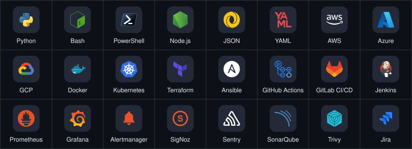
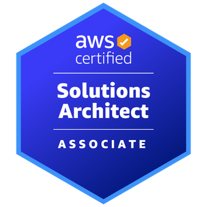
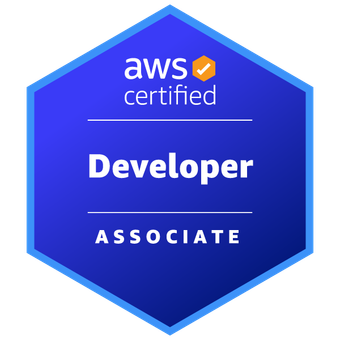
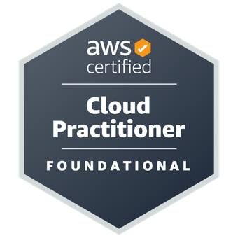
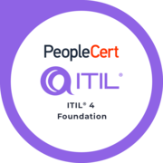
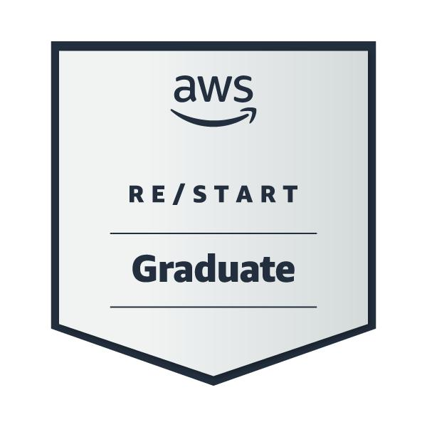

# Hi, I'm Shrivathsa Rao

I work in DevOps, mostly around cloud infrastructure and CI/CD pipelines. Docker, Terraform, and GitLab CI are where I spend most of my time, with AWS and Azure as home base. This profile's a bit sparse for now, still figuring out what's worth sharing here versus just doing quietly at work.

---

## Working On
- Building and running containerized services on **AWS ECS Fargate** across a **Go**, **Node.js/TypeScript** and **React** stack
- Automating infrastructure with **Terraform** and **GitLab CI/CD**, kept consistent across dev, staging and prod
- Observability with **Prometheus**, **Grafana**, **SigNoz** and **Sentry**
- Leading the company-wide migration from **Jira** to **GitLab**

## Learning
- **MLOps** fundamentals and working with **LLMs**
- **Kubernetes** in depth and **GitOps** workflows
- **Terraform modules** and remote backends done right
- IaC best practices for **multi-cloud** deployments

---

## Tech Stack

---

## Certified In

&nbsp;&nbsp;&nbsp;&nbsp;

